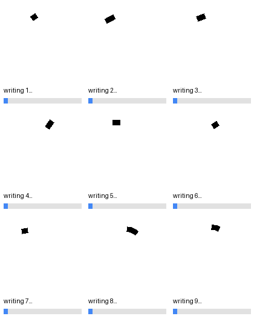
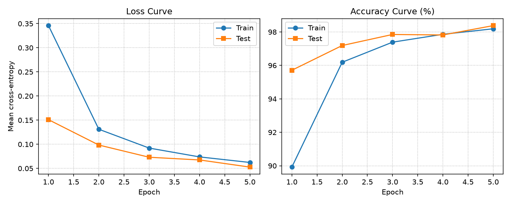
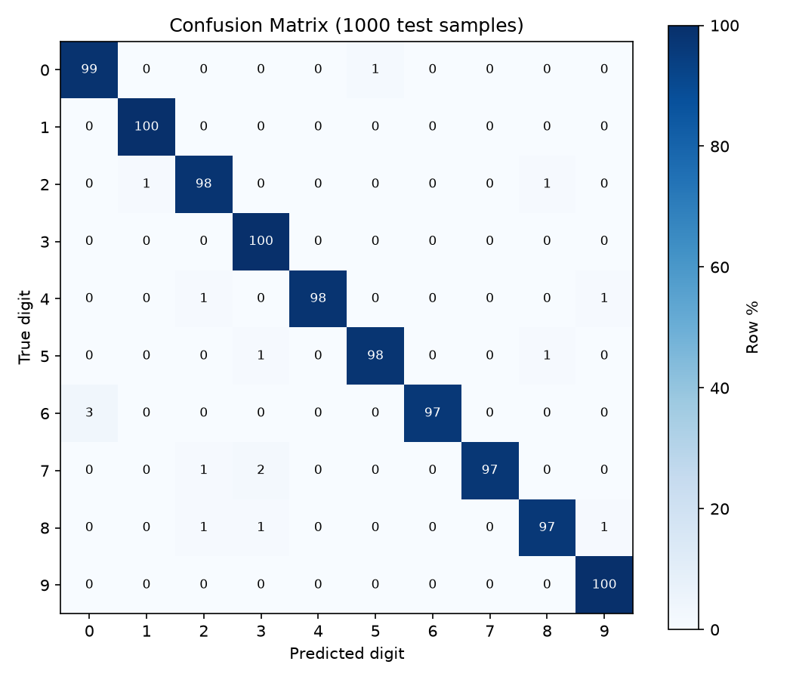

# NeuraCPP — High-Performance C++ Deep Learning Engine

A from-scratch convolutional neural network engine in modern C++17 (header-only layers + a single training driver). No Torch, no TensorFlow — just `std::vector<float>`, manual forward/backward passes, and SGD. Same depth as the [PyTorch twin](https://github.com/Scraper1010/pytorch_handwritten_digits) minus BatchNorm/Dropout, trained with plain SGD , cuz I have enough mintal issues .

```
Input (B,1,28,28)
  → Conv2D(1→32, 3×3, pad=1) → ReLU → MaxPool(2×2)      (B,32,14,14)
  → Conv2D(32→64, 3×3, pad=1) → ReLU → MaxPool(2×2)     (B,64,7,7)
  → Flatten (3136) → Linear(3136→128) → ReLU → Linear(128→10)
  → CrossEntropyLoss  (~421k params)
```

## Results

All nine digits writing themselves in sync (one file, so every cell advances together):



Below: loss/accuracy curves and the test-set confusion matrix (row-normalized %) from a real training run.





Regenerate after any training run (all three read the fresh checkpoint):

```bash
python python/plot_results.py                    # curves <- checkpoints/history.csv
python python/evaluate.py --samples 1000         # confusion matrix (add --full for 10k)
python python/make_demo_gif.py                   # digits 1-9 writing GIF
```

## Features

- **Tensor** — contiguous `vector<float>` + shape, header-only (`include/tensor.hpp`)
- **Layers** — `Conv2D`, `Linear` (He/Kaiming init), `ReLU`, `MaxPool2D`, `Flatten`, all with `forward` / `backward` and input caching
- **Loss** — numerically-stable softmax + mean cross-entropy (`CrossEntropyLoss`)
- **Optimizer** — vanilla SGD with `register_parameter / zero_grad / step`
- **Data** — IDX parser (`MNISTReader::load`) + shuffling mini-batch `DataLoader`
- **Driver** — `src/main.cpp`: train loop, per-epoch loss/acc timing, test-set evaluation

## Project structure

```
cpp-deep-learning-engine/
├── CMakeLists.txt          # Release-by-default, INTERFACE lib + neuracpp exe + CTest
├── include/
│   ├── tensor.hpp          # Tensor struct (neuracpp::)
│   ├── layer.hpp           # Abstract Layer interface
│   ├── conv2d.hpp          # Conv2D + backward for weights/bias/input
│   ├── linear.hpp          # Fully-connected layer
│   ├── relu.hpp            # ReLU
│   ├── maxpool2d.hpp       # MaxPool2D with argmax cache
│   ├── flatten.hpp         # Reshape (B,C,H,W) → (B, C·H·W)
│   ├── cross_entropy.hpp   # Softmax + cross-entropy
│   ├── sgd.hpp             # SGD optimizer
│   ├── mnist_reader.hpp    # IDX3/IDX1 parser → MNISTData
│   ├── dataloader.hpp      # Mini-batch sampler (Batch{images, labels})
│   └── model_io.hpp        # save_model / load_model (model.bin)
├── src/main.cpp            # Training + eval driver (CLI: --epochs/--output/...)
├── python/
│   ├── neuracpp_predict.py # NumPy twin of forward pass (shows the math)
│   ├── app.py              # Gradio sketchpad demo (same grid as pytorch twin)
│   ├── plot_results.py     # training_curves.png <- checkpoints/history.csv
│   ├── evaluate.py         # confusion_matrix.png from test predictions
│   ├── make_demo_gif.py    # assets/demo.gif (digits 1-9 writing)
│   └── requirements.txt    # gradio + numpy + pillow + matplotlib
├── docs/                   # per-file math pages (tensor → training, see table below)
├── assets/                 # demo.gif + training_curves.png + confusion_matrix.png
├── checkpoints/            # model.bin + history.csv (git-ignored, reproducible)
├── download_mnist.sh/.ps1  # Fetch MNIST into data/ (git-ignored)
├── .vscode/tasks.json      # CMake configure + build tasks
├── .gitignore              # build/, data/, binaries
└── LICENSE (MIT)
```

## Requirements

- CMake ≥ 3.16, Ninja (or Make), a C++17 compiler (GCC 9+ / Clang 10+ / MSVC 2019+)
- ~100 MB free for MNIST in `data/` (not committed)
- Windows: `pwsh` + MSYS2/MinGW **or** MSVC; Linux/macOS: `curl` + `gunzip`

## Quickstart

### 1. Get MNIST

```powershell
# Windows (PowerShell)
./download_mnist.ps1
```

```bash
# Linux / macOS
chmod +x download_mnist.sh
./download_mnist.sh
```

This creates `data/train-images-idx3-ubyte`, `data/train-labels-idx1-ubyte`, `data/t10k-images-idx3-ubyte`, `data/t10k-labels-idx1-ubyte`.

### 2. Configure + build

```bash
cmake -S . -B build -G Ninja -DCMAKE_BUILD_TYPE=Release
cmake --build build
```

MSVC users can omit `-G Ninja` (defaults to Visual Studio generator).

### 3. Train (5 epochs + save)

```bash
./build/neuracpp --epochs 5 --output checkpoints/model.bin
# --output "" means don't save. Full flags:
./build/neuracpp --help
# ./build/neuracpp --epochs 5 --batch-size 128 --lr 0.005 --output model.bin --load model.bin
```

Expected output:

```
[1/4] Loading MNIST dataset...
[MNISTReader] Loaded 60000 images (28x28) successfully.
...
Epoch 1/5 | Loss: 0.8234 | Acc: 74.12% | Time: 12.3s | Test Acc: 82.45%
...
Training Complete!
```

> Training is OpenMP-parallelized over batch/filter rows. The deep net (~421k params) still takes minutes per epoch on CPU - lower `epochs` for a smoke run.

### 4. Draw + classify (same grid as the PyTorch twin)

Same Gradio sketchpad UX as [pytorch_handwritten_digits](https://github.com/Scraper1010/pytorch_handwritten_digits) — white 280×280 canvas, black pencil + eraser, Clear/Classify, live top-3 confidences — but inference is pure NumPy running your `model.bin` (no torch, shows the underlying math):

```bash
pip install -r python/requirements.txt
python python/app.py --model checkpoints/model.bin
# → http://127.0.0.1:7860
```

`model.bin` layout (little-endian, see `include/model_io.hpp` and [docs/model_io.md](docs/model_io.md)): `NEURACPP` tag + 14x`u64` network shape + 8x (`u64` count + `float32` values for conv1 weights/bias, conv2 weights/bias, fc1 weights/bias, fc2 weights/bias). `python/neuracpp_predict.py` is the exact NumPy mirror of the C++ forward pass.

## API sketch

```cpp
using namespace neuracpp;

MNISTData train = MNISTReader::load("data/train-images-idx3-ubyte",
                                    "data/train-labels-idx1-ubyte");
DataLoader loader(train, 64, true);

DigitNetwork net;  // Conv(1->32) -> ReLU -> Pool | Conv(32->64) -> ReLU -> Pool
                   // Flatten(3136) -> Linear(3136->128) -> ReLU -> Linear(128->10)
CrossEntropyLoss loss; SGD opt(0.01);
// ... register all 8 parameter tensors (see src/main.cpp) ...

for (size_t epoch = 0; epoch < 5; ++epoch) {
  loader.shuffle_data();
  for (size_t b = 0; b < loader.num_batches(); ++b) {
    Batch batch = loader.get_batch(b);
    opt.zero_grad();
    Tensor logits = net.forward(batch.images);
    float batch_loss = loss.forward(logits, batch.labels);
    net.backward(loss.backward());
    opt.step();
  }
}
```

## Documentation (per-file math + worked examples)

Every header is fully commented, and each has a companion page with the
equations, matrix shapes, and a hand-worked numeric example:

| Component | Code | Math + examples |
|---|---|---|
| Tensor (storage + row-major indexing) | `include/tensor.hpp` | [docs/tensor.md](docs/tensor.md) |
| Layer interface (forward/backward contract) | `include/layer.hpp` | [docs/layer.md](docs/layer.md) |
| Conv2D (sliding-window dot products) | `include/conv2d.hpp` | [docs/conv2d.md](docs/conv2d.md) |
| Linear (output = input·weights + bias, and its 3 gradients) | `include/linear.hpp` | [docs/linear.md](docs/linear.md) |
| ReLU (max(0,x) + gradient mask) | `include/relu.hpp` | [docs/relu.md](docs/relu.md) |
| MaxPool2D (winner-take-all downsampling) | `include/maxpool2d.hpp` | [docs/maxpool2d.md](docs/maxpool2d.md) |
| Flatten (4D reshape, order-preserving) | `include/flatten.hpp` | [docs/flatten.md](docs/flatten.md) |
| CrossEntropyLoss (stable softmax + NLL) | `include/cross_entropy.hpp` | [docs/cross_entropy.md](docs/cross_entropy.md) |
| SGD (W -= lr * grad) | `include/sgd.hpp` | [docs/sgd.md](docs/sgd.md) |
| MNISTReader (IDX byte parsing) | `include/mnist_reader.hpp` | [docs/mnist_reader.md](docs/mnist_reader.md) |
| DataLoader (shuffle + mini-batch gather) | `include/dataloader.hpp` | [docs/dataloader.md](docs/dataloader.md) |
| Checkpoint format (tag + shapes + blobs) | `include/model_io.hpp` | [docs/model_io.md](docs/model_io.md) |
| Training driver (4-phase loop + CLI) | `src/main.cpp` | [docs/training.md](docs/training.md) |
| Main train loop (the epoch/batch code) | `src/main.cpp` | [docs/main.md](docs/main.md) |
| Python inference (NumPy twin + Gradio app) | `python/` | [docs/inference.md](docs/inference.md) |

## Design notes

- All tensors are NCHW row-major `float`; gradients mirror parameter shapes exactly.
- `Conv2D`/`Linear` use He-normal init (`σ = sqrt(2/fan_in)`), biases zeroed.
- `CrossEntropyLoss` subtracts per-row max-logit before `exp` and clamps `p ∈ [1e-7, 1]` before `log`.
- `MaxPool2D` caches winning input indices so `backward` routes grads 1:1.
- `DataLoader::get_batch` handles the final partial batch (`ceil(N/B)` batches).


## Contributing

Header-only style: one class per header in `include/`, `neuracpp::` namespace, `#ifndef XXX_HPP` guards, `forward` caches what `backward` needs. Keep `src/main.cpp` as the thin driver; put reusable logic in headers.

## License

MIT — see [LICENSE](LICENSE).
